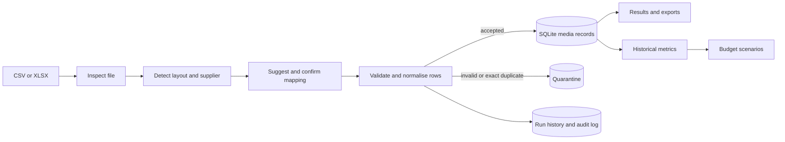

# PIM Analytics

**Offline-first mobile ingestion, normalisation, analytics, and budget forecasting for paid-media data.**

PIM Analytics is a React Native application created for PlanIt Media. It turns CSV and Excel exports from advertising platforms into a consistent local dataset: users can inspect a file, confirm its column mapping, validate and process its rows, review exceptions, analyse campaign performance, and model future budget allocations—all on the device, without an application server.

The checked-in configuration currently enables **Meta** and **TikTok** imports. A Google Ads mapping is present in the source but is disabled.

> [!NOTE]
> This repository is a final-year group project and portfolio project. See [Reinhardt's contribution](#reinhardts-contribution) for the authorship boundary used in this README.

## What the application does

- Imports `.csv` and `.xlsx` files up to 25 MB.
- Detects likely header rows, worksheets, source platforms, blank rows, and summary rows.
- Suggests mappings from platform-specific columns to one standard media-record model.
- Stores immutable mapping confirmations so each processing run can be reproduced against the approved file layout.
- Normalises dates, numeric values, objectives, placements, platforms, currencies, and campaign types.
- Converts supported non-ZAR spend with dated, locally managed exchange rates.
- Detects exact duplicates with SHA-256 fingerprints and flags records that share a business key but contain different metrics.
- Quarantines invalid and exact-duplicate rows without discarding their source data.
- Keeps processing history, validation errors, reconciliation totals, and an audit log.
- Provides filterable results and exports clean data or processing reports as CSV/XLSX.
- Calculates historical CPC, CPM, CTR, and conversion metrics.
- Builds recommended and manual budget scenarios from 3-, 6-, or 12-month baselines.
- Supports local Administrator, Analyst, and Viewer roles.

## Application flow



### 1. File inspection

The upload service validates the filename, MIME type, size, and basic file signature before parsing. It then:

1. Reads the selected file into a byte array.
2. Calculates a SHA-256 hash and rejects a repeat upload to the same advertising account.
3. Parses CSV with Papa Parse or XLSX with SheetJS.
4. Scans up to the first 15 rows for the most likely header.
5. Separates detail, summary, and blank rows.
6. Detects whether the columns resemble Meta, TikTok, or Google Ads and checks that against the chosen account.
7. Saves a private working copy in the application's document storage and registers its metadata in SQLite.

CSV decoding handles UTF-8 (with or without BOM), UTF-16 LE/BE, and a Windows-1252 fallback. For workbooks, users can select a worksheet and change the detected header row.

### 2. Mapping

Supplier-specific exact mappings and standard-field synonyms produce an initial suggestion. The user can review each source column, skip irrelevant columns, or map it to fields such as reporting month, objective, spend, impressions, clicks, conversions, campaign, ad group, placement, platform, and currency.

Before processing, the service validates required fields and writes a **mapping confirmation** containing the file hash, source columns, supplier defaults, worksheet, header row, and ordered mapping. Database triggers make confirmations immutable. Reusable mapping profiles can also be saved per supplier and file type.

### 3. Validation and normalisation

Rows are transformed in chunks of 500. The processor:

- parses day-first dates and stores a `YYYY-MM` reporting month;
- parses formatted decimal and whole-number metrics;
- rejects missing required values and negative spend, impressions, clicks, or conversions;
- standardises platform and placement values;
- classifies source objectives into supported campaign types;
- uses supplier defaults where the approved mapping permits them;
- converts spend to ZAR using the latest rate on or before the reporting month-end;
- marks records without an applicable FX rate or recognised campaign type as ineligible for forecasting;
- hashes a stable representation of each record for exact-duplicate detection; and
- builds a separate business key to warn about possible duplicates while retaining records whose metrics differ.

Invalid rows and exact duplicates go to quarantine with their original values and reasons. Potential business-key duplicates remain in the clean dataset with a review flag.

### 4. Transactional persistence and run versioning

The processor stages transformed results in memory and persists the records, validation issues, quarantine entries, run totals, file status, and audit events in one SQLite transaction. A mutex serialises database access; transactions use `BEGIN IMMEDIATE`, and nested work uses savepoints.

Only one run per uploaded file is active for reporting. Reprocessing supersedes the earlier active run but retains its history. On application startup, a run left in `running` state is marked failed and its partial records are removed.

### 5. Analytics and forecasting

Reporting queries use only active runs. Results can be filtered by supplier, client, account, platform, campaign type, month, file, run, or search text, with aggregate totals for spend, impressions, clicks, conversions, and missing values.

The forecasting engine groups eligible history by platform and campaign type. It supports:

- 3-, 6-, and 12-month baseline windows;
- CPC, CPM, CTR, and conversion-rate calculations;
- a seasonal CPC adjustment when at least 12 months of history are available;
- observed variability bands, with a 20% fallback when history is insufficient;
- a log-log spend-to-click model for diminishing returns when at least six usable observations exist and model fit is adequate;
- an efficiency-weighted recommended allocation; and
- manual allocations that must reconcile to 100%.

Forecast outputs are estimates derived from historical data, not guarantees. The interface surfaces limited-history and model-quality warnings.

## Architecture

The application uses a local, layered architecture:

| Layer | Responsibility | Key locations |
|---|---|---|
| Screens and components | Upload, mapping, processing, results, budget, administration, and review workflows | `src/screens/`, `src/components/` |
| Navigation and state | Authenticated routing, bottom tabs, application initialisation, and session state | `src/navigation/`, `src/state/` |
| Services | Authentication, ingestion, mapping, processing, quarantine, reporting, forecasting, reference data, and audit events | `src/services/` |
| Database | Connection adapter, serialised access, schema migrations, models, seeding, and interrupted-run recovery | `src/database/` |
| Platform adapters | Expo file storage, secure token storage, cryptographic randomness, picked-file reading, and sharing | `src/platform/` |
| Configuration | Suppliers, standard fields, objective rules, and processing thresholds | `src/config/` |

There is no remote API or server-side application in this repository. Core data processing and persistence happen locally.

## Database design

The SQLite schema is installed through a versioned migration and uses foreign keys, check constraints, unique constraints, indexes, partial unique indexes, and triggers. Including the migration ledger, it contains 19 tables grouped as follows:

| Area | Tables |
|---|---|
| Reference data | `suppliers`, `clients`, `advertising_accounts`, `currency_rates` |
| Identity and access | `roles`, `users`, `user_roles`, `user_sessions` |
| Ingestion and mapping | `uploaded_files`, `mapping_profiles`, `mapping_confirmations` |
| Processing and quality | `processing_runs`, `media_records`, `validation_errors`, `quarantined_records`, `processing_logs` |
| Forecasting | `forecast_scenarios`, `forecast_allocations` |
| Schema control | `schema_migrations` plus SQLite's `PRAGMA user_version` |

Notable integrity controls include one running run per file, one active run per file, immutable mapping confirmations, one uploaded file hash per account, and one media record per source row within a run.

## Security and privacy

Implemented controls include:

- local role-based permissions for Administrator, Analyst, and Viewer operations;
- PBKDF2-HMAC-SHA-256 password hashing with a random 16-byte salt and a stored iteration count;
- cryptographically random 32-byte session tokens, with only their SHA-256 hashes stored in SQLite;
- seven-day session expiry and revocation on logout or account deactivation;
- session tokens stored through Expo SecureStore;
- generic login errors, failed-attempt counts, and authentication audit events;
- parameterised SQL throughout the service layer;
- file type, signature, size, supplier, and content-hash validation;
- Android backups disabled in the Expo configuration; and
- no network backend required for core operation.

Important boundaries:

- The SQLite database and imported files are stored in the application's local document area, but this code does **not** implement database or file encryption at rest.
- Exported data can leave the application when a user explicitly invokes the operating system's share sheet.
- The included evaluation administrator credentials are hard-coded for demonstration. Remove the seed account and provision credentials appropriately before any real deployment.
- Local authentication controls access through this application; they are not a substitute for device-level security.

## Technology stack

| Category | Technology |
|---|---|
| Language | TypeScript, SQL |
| Mobile | React Native 0.88, React 19, Expo SDK 58 |
| Navigation | React Navigation 7 |
| Database | SQLite via `expo-sqlite` |
| File parsing | Papa Parse, SheetJS (`xlsx`) |
| Device services | Expo FileSystem, Document Picker, SecureStore, Crypto, Sharing |
| Cryptography | Expo Crypto, `@noble/hashes` |
| Testing | Jest, ts-jest, Node's SQLite test adapter |

## Getting started

### Prerequisites

- Node.js and npm
- Android Studio with an Android SDK and emulator, or a connected Android device
- Java/JDK compatible with the installed Android/Gradle toolchain

The repository includes an Android native project. iOS settings and an `ios` npm script are present, but no generated `ios/` directory is included in this snapshot.

### Install

```bash
cd pim
npm ci
```

Use `npm install` instead if you intentionally want npm to update the lockfile.

### Run on Android

Start an emulator or connect a device, then build and launch the native application:

```bash
npm run android
```

For the Metro-first workflow described by the original project documentation:

```bash
npm start
```

Press `a` in the Expo terminal to open Android. If an emulator cannot reach Metro, forward the development port and retry:

```bash
adb reverse tcp:8081 tcp:8081
```

### Evaluation login

On a new database, application initialisation creates this local demonstration account:

```text
Email:    admin@planitmedia.com
Password: PlanIt2026!
```

These credentials are for local evaluation only.

### Quality checks

```bash
npm run typecheck
npm test -- --runInBand
```

Verified against the supplied repository snapshot:

- TypeScript check: passed
- Jest: 8/8 suites passed, 76/76 tests passed

### Synthetic fixtures

The repository contains synthetic Meta and TikTok samples under `fixtures/synthetic/`. Regenerate them with:

```bash
npm run fixtures
```

The fixture data is synthetic and is intended for development and evaluation.

## Project structure

```text
pim/
├── App.tsx                     # Application root
├── android/                    # Generated native Android project
├── assets/                     # App icons and splash assets
├── fixtures/synthetic/         # Synthetic Meta and TikTok imports
├── scripts/                    # Fixture generator
├── src/
│   ├── components/             # Shared presentation components
│   ├── config/                 # Suppliers, fields, rules, limits
│   ├── database/               # Schema, migrations, connection, recovery
│   ├── navigation/             # Authenticated navigation and role gates
│   ├── platform/               # Expo device and storage adapters
│   ├── screens/                # User-facing workflows
│   ├── services/
│   │   ├── audit/              # Audit event persistence
│   │   ├── auth/               # Users, passwords, sessions, permissions
│   │   ├── forecasting/        # Metrics, history, models, scenarios
│   │   ├── ingestion/          # CSV/XLSX parsing and registration
│   │   ├── mapping/            # Suggestions, profiles, confirmations
│   │   ├── processing/         # Normalisation, validation, quarantine
│   │   ├── reference/          # Clients, accounts, rates
│   │   └── reporting/          # Results, history, CSV/XLSX exports
│   ├── state/                  # App initialisation and session state
│   ├── ui/                     # Theme and formatting
│   └── utils/                  # Hashing and async helpers
└── __tests__/                  # Unit, integration, and end-to-end tests
```

## Reinhardt's contribution

Reinhardt Lubbe's stated responsibilities on the three-person project were the database and backend/data-processing areas. They included:

- designing and implementing the relational SQLite schema, constraints, indexes, and versioned migration path;
- building database initialisation, reference-data seeding, serialised transactions, and interrupted-run recovery;
- developing service-layer workflows for ingestion, validation, normalisation, persistence, duplicate detection, and quarantine;
- supporting mapping confirmations, processing history, auditability, and SQL-backed reporting; and
- implementing the data access and processing foundations used by analytics and forecasting.

The uploaded archive contains the corresponding database schema, migration runner, service modules, transaction handling, processing pipeline, reporting queries, and tests, so those capabilities are directly verifiable in the source. The archive does **not** include Git history or another ownership record; therefore, the allocation of those files and features to Reinhardt is author-provided project attribution rather than something the source snapshot alone can prove.

## Project status

This is a portfolio and academic project rather than a production release. Before production use, replace the demo-account bootstrap, define a credential-provisioning process, evaluate encryption at rest, establish secure backup/retention requirements, review dependencies, add deployment-specific monitoring, and complete device-level acceptance testing.

## Licence

No licence file is included in the supplied repository. Unless the project owners add one, the source should be treated as all rights reserved.
